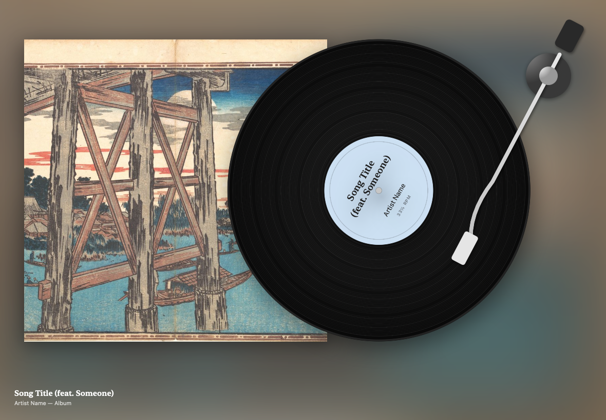

# Vinyl for iPad and iPhone

A record player for whatever you're listening to. Put an iPad on a stand and
it shows the album sleeve with the record slid out, spinning at 33⅓, with the
tonearm working its way through the song. On iPhone it also sits on the Lock
Screen and in the Dynamic Island as a Live Activity.



This is an iOS port of [Vinyl for macOS](https://github.com/CycloneDraco/Vinyl)
(MIT). The 3D scenes run the same three.js renderer as the Mac app.

There are no usage limits or accounts beyond your own Spotify login.

## Features

- **Sleeve scene**, drawn natively and made for an always-on display: the cover
  with the record overlapping it, in a room tinted with the album's colours.
  Each album gets its own translucent pressing (clear colour, splatter or
  starburst, picked from the cover), or choose one, or classic black.
- **Hands-on**: touch the record and it stops under your finger; turn it to
  move through the song (one turn = 15 seconds), fling it and it carries on
  before the motor takes back over. Pick up the tonearm and drop it on a
  groove to play from there, or park it on its rest to pause.
- **3D scenes from the Mac app**: Turntable (top-down), Listening Room and
  After Hours, with the recently played albums stacked beside the deck.
- **Spotify on any device.** It shows what's playing on your phone, Mac,
  speaker or TV, so the iPad can be a display for music playing elsewhere.
- **Apple Music** playing in the Music app on the same device.
- **Controls**: tap the screen to show them, tap the record to play or pause,
  swipe sideways to skip, and drag the progress bar to seek.
- **Crate**: a 3D shelf you flick through, Cover Flow style, of the albums
  you've played in Vinyl (up to 300) and your saved Spotify albums, with
  search. Tap the album in front to open it and see its songs; tap a song to
  play from there. Starting Spotify albums needs Premium.
- **Always-on display**: keeps the screen awake, dims for night-time, shows an
  optional clock, and nudges the image every few minutes to protect OLED
  screens from burn-in.
- **Live Activity** (iPhone): record, title, a running progress bar, and
  play/pause/skip buttons on the Lock Screen and in the Dynamic Island.

## Install

You need a free Apple ID, a Mac or PC with [Sideloadly](https://sideloadly.io)
(or AltStore), and a cable.

1. Download `Vinyl.ipa` from this repository's **Releases** page. It's built
   automatically by GitHub Actions on every push.
2. Connect the iPad or iPhone, open Sideloadly, drop in `Vinyl.ipa`, enter
   your Apple ID and click **Start**.
3. On the device, go to **Settings → General → VPN & Device Management**,
   tap your Apple ID and choose **Trust**.
4. If iOS asks, turn on **Settings → Privacy & Security → Developer Mode** and
   restart.

Apps signed with a free Apple ID stop opening after 7 days. Run Sideloadly
again to re-sign; your settings are kept. A paid developer account extends
this to a year.

## Spotify setup

The app uses the Client ID set in `Vinyl/NowPlaying/SpotifyAuth.swift`. In the
[Spotify developer dashboard](https://developer.spotify.com/dashboard), under
the app's settings:

- **Redirect URI** must include `vinyl-ios://spotify-login-callback`.
- Under **APIs used**, tick **Web API** as well as iOS.
- In development mode, only accounts listed under **User Management** can log
  in (plus your own).

Showing what's playing works on any Spotify account. Spotify only lets other
apps play, pause and skip for **Premium** accounts.

Vinyl asks Spotify for playback state about every 5 seconds while it's open,
and right when a song should end. That's well within Spotify's rate limits for
a single user. It stops asking when Vinyl isn't on screen.

## About the Live Activity

Vinyl has no server, so the Live Activity is updated by the app itself:

- While Vinyl is open (an iPhone on a stand or charger), it updates live.
- Tapping play, pause or skip on it runs in the background and refreshes it.
- Otherwise iOS suspends Vinyl, and the progress bar keeps running by itself to
  the end of the current song. After that it reads "Open Vinyl to refresh"
  until you do.

Live, closed-app updates would need Apple push notifications, which need a
server and a paid developer account. On iPad, use the full-screen display
instead.

## Keeping it on screen

- Leave **Keep Screen On** enabled in Vinyl's settings and keep the device
  plugged in.
- To lock the device to Vinyl so it can't be swiped away, use **Guided
  Access**: Settings → Accessibility → Guided Access. Then triple-click the
  side (or top) button while Vinyl is open.

## Building

GitHub Actions builds the unsigned `.ipa`
([`.github/workflows/build-ipa.yml`](.github/workflows/build-ipa.yml)) and
attaches it to a release. To build locally you need Xcode 16 or later:

```bash
brew install xcodegen
xcodegen generate
open Vinyl.xcodeproj
```

| Path | What |
| --- | --- |
| `Vinyl/App` | App entry point |
| `Vinyl/NowPlaying` | Spotify (PKCE login + Web API), Apple Music, artwork, the combined now-playing state |
| `Vinyl/Views` | Sleeve scene, controls, settings, onboarding |
| `Vinyl/Rendering` | Web view host for the three.js scenes |
| `Vinyl/LiveActivity` | Starts, updates and ends the Live Activity |
| `VinylWidgets` | The Live Activity UI (widget extension) |
| `Shared` | Live Activity data and the play/pause/skip intents, used by both targets |
| `Renderer` | three.js scenes from Vinyl for macOS, unchanged |

## Licence

MIT, as the original. See [`LICENSE`](LICENSE) and
[`THIRD_PARTY_NOTICES.md`](THIRD_PARTY_NOTICES.md) for three.js, the CC0
textures and the public-domain wall art.
